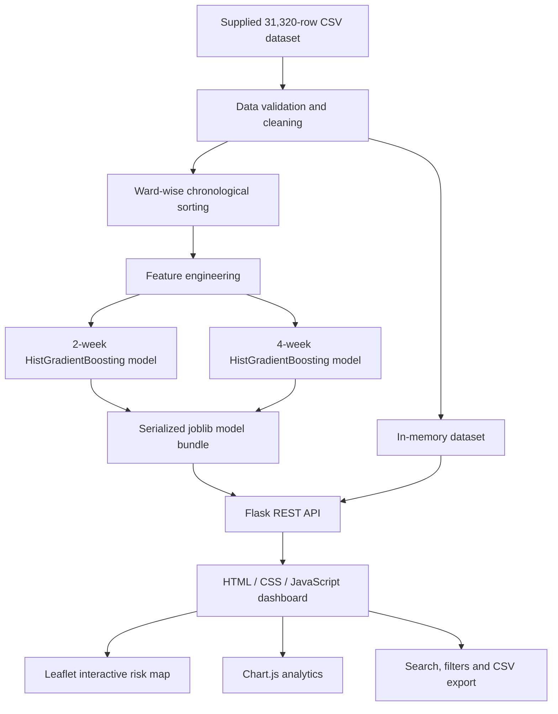

# Dengue Watch BD — Architecture & Model Notes

## 1. System architecture

## 2. Data pipeline and lag logic

The supplied data is a weekly ward-level panel. Each time series is grouped by `(city, ward_id)` and sorted by `date`; lag features are calculated inside each group, never across ward boundaries.

For a row observed at week *t*, the pipeline calculates:

- `rainfall_lag_1w` through `rainfall_lag_4w` using rainfall from weeks *t−1* to *t−4*.
- `rainfall_sum_2w` and `rainfall_sum_4w` using trailing rolling sums ending at *t*.
- 2- and 4-week rolling means for average temperature and relative humidity.
- Dengue case lags for weeks *t−1* to *t−4* and a trailing 4-week case mean.
- Current weather, population density, water-logging risk and sanitation score.

The 2-week target is the ward's observed case count at *t+2 weekly records*. The 4-week target is the case count at *t+4 weekly records*. The dataset's regular weekly cadence is used as the time index. The prediction date is shown as the latest observation date plus 14 or 28 days.

## 3. Model selection rationale

Two independent `HistGradientBoostingRegressor` models are trained. Gradient-boosted decision trees can learn non-linear relationships and interactions between rainfall, humidity, temperature, ward vulnerability and recent case history without requiring feature scaling. Histogram-based training is efficient for a dataset of this size and supports fast local inference. A `log1p` transform is applied to the non-negative case-count target during training; `expm1` reverses the transform at inference, and negative predictions are clipped to zero.

The model is a supervised regression model, not a hand-written static threshold rule. Risk tiers are applied after inference using quantiles of the training-period ward-level target counts. The 0–100 risk score is a normalized severity index relative to the Critical tier threshold; it is not a probability of outbreak.

## 4. Chronological validation split

The split is based on unique dates, not random row shuffling:

1. Sort the complete dataset by date and identify the 80th-percentile unique date as the boundary.
2. Train only on rows before the boundary whose *target date* is also before the boundary. This prevents a training label from reaching into the holdout period.
3. Evaluate on rows at or after the boundary for which the future target is present.
4. Report Mean Absolute Error (MAE) and Root Mean Squared Error (RMSE) separately for 2-week and 4-week models.

This is a chronological holdout, not cross-validation. Model performance should be rechecked on new seasons/cities and compared against a simple persistence baseline before operational deployment.

## 5. Runtime and compute/API cost controls

- The dataset is read once at application startup and reused in memory for API requests.
- Feature engineering and model fitting happen once at startup only when the serialized model is absent or its dataset row count/end date has changed.
- Both fitted models and metadata are saved as one compressed `joblib` artifact. Normal API inference loads this artifact; it does not retrain on every request.
- Predictions are local CPU inference; no paid weather, LLM or external prediction API is called in a loop.
- Map tiles and front-end chart libraries are fetched from public CDNs/OpenStreetMap. These are presentation dependencies, not prediction services. For offline deployment, self-host these assets and configure a local tile source.
- The API uses bounded pagination for raw records and returns only the requested page. CSV export is generated only when requested.
- No LLM is used, so LLM token cost is zero. No recurring third-party weather API calls are made by this prototype.

## 6. Data flow and interface

The browser requests summary KPIs, filters, risk predictions, historical trends and paginated records from Flask endpoints. The risk map receives the prediction tier and score for each ward. The raw dataset explorer exposes all twelve source columns and supports city, ward, date and text filtering. The user can export source rows and prediction rankings as CSV.

## 7. Known data limitations and responsible use

- The dataset contains historical weather observations, not forecast weather. The 2/4-week dengue estimates condition on the latest observed weather, lagged weather, vulnerability and case history. They are not coupled to a future weather forecast feed.
- The dataset has population density but not ward area or total population. Therefore the prototype does not claim per-capita incidence rates; risk tiers use predicted weekly case counts and include density as a model feature.
- The source has no ward latitude/longitude or official polygons. The displayed map points are approximate schematic offsets around city centres. They must not be interpreted as official ward geographies.
- Synthetic future observations are not created. If no actual source record exists for a later week, the app forecasts from the latest available row.
- This is a hackathon decision-support prototype, not a clinically validated system or official outbreak alert. Public-health deployment requires expert review, external validation, current weather feeds, authoritative GIS data, monitoring for drift and documented intervention thresholds.
